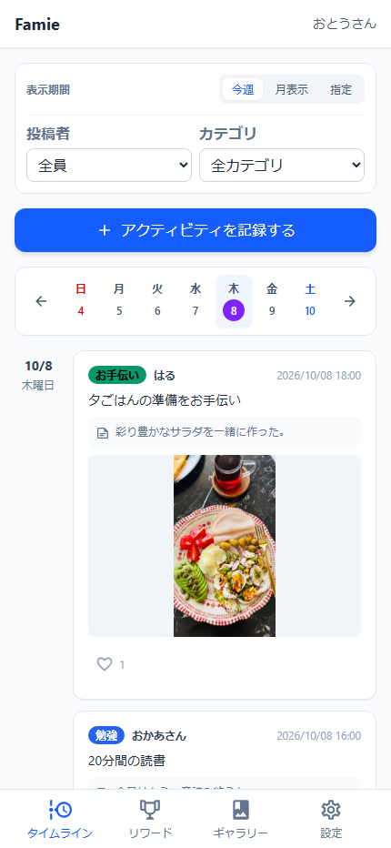
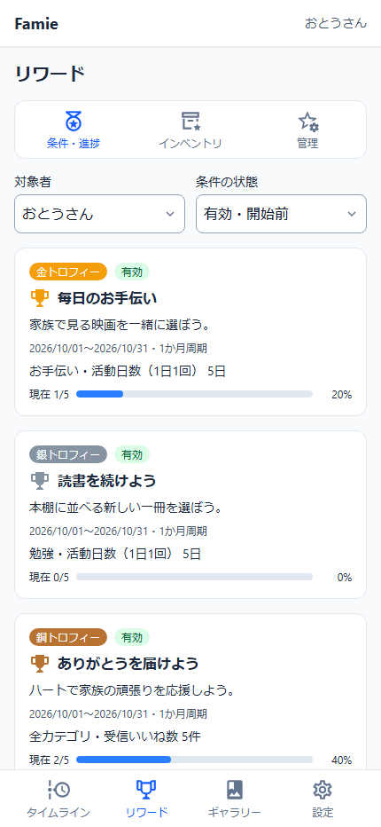
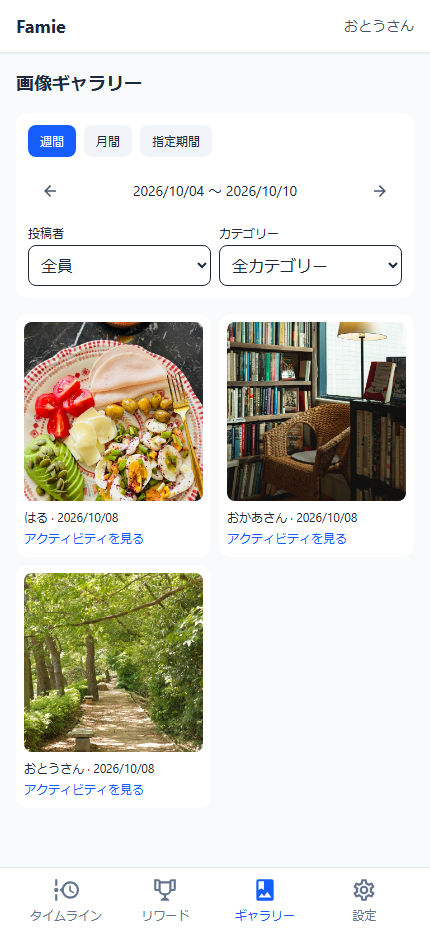

<h1 align="center"> Famie</h1>

[English](README.md) | **日本語**

   

<i>
Release CI は main ブランチの検査結果です。商用環境への配置状況や稼働率を示すものではありません。
</i>

**家族の日常に、小さな「いいね」を。**

Famieは、毎日の活動を記録し、家族の様子を知り、ハートで応援し合うためのシンプルな場所です。宿題を終えたこと、夕ごはんを手伝ったこと。何気ない毎日の頑張りを、家族で見つけてみませんか。

**[famie.coで使い始める](https://famie.co/)**

<table align="center">
  <thead>
    <tr><th>タイムライン</th><th>リワード</th><th>ギャラリー</th></tr>
  </thead>
  <tbody>
    <tr>
      <td width="33%"></td>
      <td width="33%"></td>
      <td width="33%"></td>
    </tr>
  </tbody>
</table>

サンプル写真の出典：<a href="https://www.pexels.com/">Pexels</a>

*日本語UIと架空のサンプルデータを使用しています。画像を選ぶと原寸で表示できます。*

## 毎日の頑張りに、ひとことの応援を

- **家族のタイムラインを残す。** 日付・カテゴリとともに活動を記録し、必要に応じてメモを添えられます。
- **お互いを応援する。** ほかの家族の活動にいいねを付け、集まったハートを確認できます。自分が付けたいいねは取り消せます。
- **見たい出来事を探す。** 週・月ごとに眺めたり、期間・家族メンバー・カテゴリで絞り込んだりできます。
- **活動に写真を添える。** 写真付きの記録を、ギャラリーから振り返れます。
- **頑張りをリワードにつなげる。** 繰り返しの目標を設定し、進捗を確認して、獲得したトロフィーを集められます。
- **家族に合った場所にする。** 家族の管理者がメンバーとカテゴリを管理します。活動の編集は記録した本人が行います。

## 言葉も見た目も自分らしく

日本語・英語に対応し、アカウントに保存した表示言語を別の端末でも使えます。ログイン前はブラウザごとに言語を選べます。アカウント関連のメールも日英に対応し、家族名・活動内容・メモなど、保存した文章は入力した言葉のまま表示します。

PWAとしてホーム画面に追加し、ライト／ダークテーマや表示名を自分に合わせて変更できます。日本語のヘッダーでは、名前の敬称の有無も選べます。

## 家族のための場所

管理者が家族を作成し、メンバーを追加します。活動・写真・カテゴリ・リワードはその家族の中で共有します。各アカウントが所属できる家族は1つで、管理者と一般メンバーの役割があります。Famieは決済処理を行いません。

## 使用技術

フロントエンドはNuxt 4・Vue・TypeScript・Tailwind CSS、バックエンドはLaravel・Sanctum・PostgreSQLで構成しています。

カバレッジはバックエンドのSQLite全体・PostgreSQL重点検証・フロントのユーティリティを分けて計測します。公開バッジは安全な公開経路の承認まで保留しています。[計測範囲と再開条件](docs/operations/runbooks/coverage-ci-notes.md)を参照してください。

---

<h6 align="center">Copyright © 2026 MAGIC METHODS.</h6>
