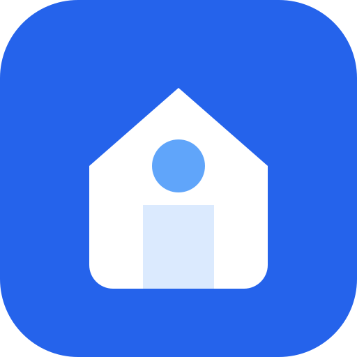
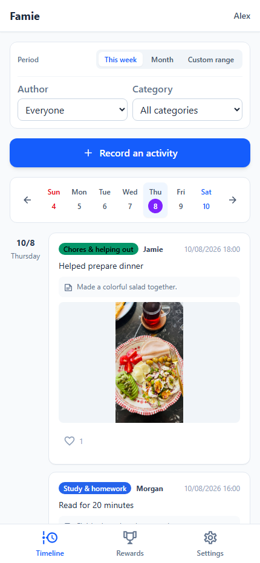
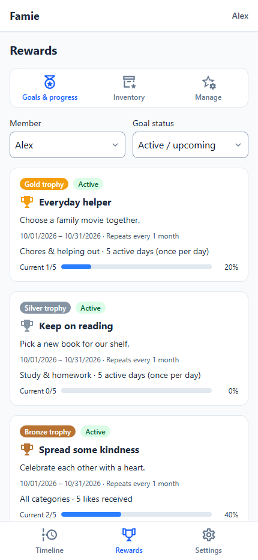
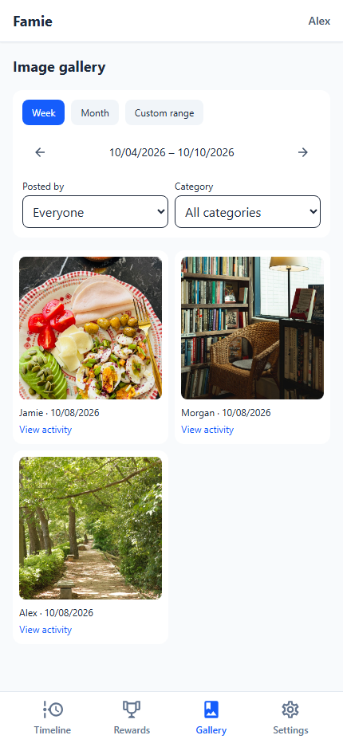

<h1 align="center"> Famie</h1>

  

**Small moments. Shared as a family.**

Famie is a simple place to record everyday activities, see what your family has been doing, and encourage one another with a heart. From finishing homework to helping with dinner, ordinary moments deserve a little recognition.

**[Start using Famie at famie.co](https://famie.co/)**

<table align="center">
  <thead>
    <tr><th>Timeline</th><th>Rewards</th><th>Gallery</th></tr>
  </thead>
  <tbody>
    <tr>
      <td width="33%"></td>
      <td width="33%"></td>
      <td width="33%"></td>
    </tr>
  </tbody>
</table>

Sample photos: <a href="https://www.pexels.com/">Pexels</a>.

*English interface with illustrative sample data. Select an image to view it at full size.*

## A little encouragement, every day

- **Keep a family timeline.** Record an activity with a date, category, and optional note.
- **Celebrate each other.** Like another family member's activity, see the hearts it receives, and undo your own like whenever you want.
- **Find the moments you need.** Browse by week or month, or filter by date range, family member, and category.
- **Keep photos with your activities.** Attach a photo and revisit family moments in the gallery.
- **Turn progress into rewards.** Set recurring goals, track progress, and collect earned trophies.
- **Make it your family's space.** Family administrators manage members and categories. Each person edits their own activity records.

## Your language, your style

Use Famie in Japanese or English, and save your language preference to your account across devices. Before logging in, choose a language for that browser. Account emails also support both languages, while family names, activity notes, and other saved content keep their original wording.

Add Famie to your home screen as a PWA, choose a light or dark theme, and customize your display name. The Japanese header also offers an optional name suffix.

## Made for families

An administrator creates a family and adds its members. Activities, photos, categories, and rewards stay within that family. Each account belongs to one family, with administrator and regular-member roles. Famie does not process payments.

## Built with

Nuxt 4, Vue, TypeScript, and Tailwind CSS on the frontend; Laravel, Sanctum, and PostgreSQL on the backend.

---

<h6 align="center">Copyright © 2026 MAGIC METHODS.</h6>
